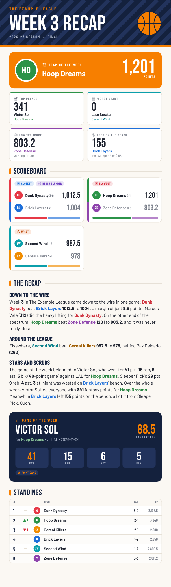

# fantasy_recap

**Turn your ESPN fantasy league's week into a story your group chat will actually read.**

fantasy_recap reads a week of matchups from an ESPN fantasy basketball or football league (scores, lineups, bench points, close games, blowouts, the week's best single games) and writes a short, trash-talking recap about it. It can also lay the whole week out as a one-page, phone-sized PDF made for dropping into a group chat.

- Works with head-to-head points and category leagues, public or private
- Basketball and football
- The story can come from Claude (with an API key or your Claude Code login), Codex, OpenAI, or any OpenAI-compatible server such as OpenRouter or Ollama; with none set up, a built-in template writes a plainer one, so it always works
- Weekly JSON export and a ready-made systemd timer for hands-off Monday recaps

<p align="center">
  
</p>

## Sample recap

This is the built-in template story for a made-up league (every team, player and stat is invented). You can make it yourself with `python scripts/sample_recap.py`, no ESPN league or API key needed. With a [story writer](#choosing-a-story-writer) set up, a model writes three or four funnier paragraphs, with headlines, from the same facts.

```text
Team of the Week: Hoop Dreams (1,201)

Down to the wire
Week 3 in The Example League came down to the wire in one game: Dunk Dynasty beat Brick Layers 1012.5 to 1004, a margin of just 8.5 points. Marcus Vale (312) did the heavy lifting for Dunk Dynasty. On the other end of the spectrum, Hoop Dreams beat Zone Defense 1201 to 803.2, and it was never really close.

Around the league
Elsewhere, Second Wind beat Cereal Killers 987.5 to 978, behind Pax Delgado (262).

Stars and scrubs
The game of the week belonged to Victor Sol, who went for 41 pts, 15 reb, 6 ast, 5 blk (40-point game) against LAL for Hoop Dreams. Sleeper Pick's 29 pts, 9 reb, 4 ast, 3 stl night was wasted on Brick Layers' bench. Over the whole week, Victor Sol led everyone with 341 fantasy points for Hoop Dreams. Meanwhile Brick Layers left 155 points on the bench, all of it from Sleeper Pick. Ouch.

Standings take: Dunk Dynasty sits alone on top at 3-0. Hoop Dreams made the biggest jump, up 1 spot to No. 2. Cereal Killers took the biggest tumble, down 1 spot to No. 3. Zone Defense brings up the rear at 0-3.
```

## Quickstart

You need Python 3.10 or newer and the league ID of an ESPN fantasy league.

```bash
git clone https://github.com/scottbshaffer/fantasy_recap.git
cd fantasy_recap
python3 -m venv .venv
source .venv/bin/activate          # Windows: .venv\Scripts\activate
pip install -r requirements.txt

# See what the output looks like before touching ESPN
python scripts/sample_recap.py --pdf sample.pdf

# Point it at your league
cp .env.example .env               # then set ESPN_LEAGUE_ID (and the cookies if it's private)
python -m fantasy_recap --previous --pdf recaps/last-week.pdf
```

`--previous` recaps the week that just ended, which is what you want on a Monday. Leave it off to get a "so far" story about the week in progress.

## Configuration

Settings come from environment variables, or from a `.env` file in the folder you run it from. Command line flags override them.

| Variable | Needed | What it is |
| --- | --- | --- |
| `ESPN_LEAGUE_ID` | yes | The number after `leagueId=` in your league's URL on fantasy.espn.com |
| `ESPN_SPORT` | no | `basketball` (default) or `football` |
| `ESPN_YEAR` | no | The season. Picked automatically if blank. Basketball seasons are named by the year they end (2026-27 is `2027`); football seasons by the year they start (the 2026 NFL season is `2026`). |
| `ESPN_S2` | private leagues | The `espn_s2` cookie from your browser |
| `ESPN_SWID` | private leagues | The `SWID` cookie from your browser, with or without the braces |
| `FANTASY_RECAP_PROVIDER` | no | Who writes the story: `anthropic`, `claude-code`, `codex`, `openai`, `openai-compatible` or `template`. Blank picks the first one available. |
| `FANTASY_RECAP_MODEL` | no | Model id for whichever story writer runs |
| `ANTHROPIC_API_KEY` | no | Lets Claude write the story through the Anthropic API. Get one at [console.anthropic.com](https://console.anthropic.com). |

The other story-writer settings (`OPENAI_API_KEY`, `FANTASY_RECAP_BASE_URL`, `FANTASY_RECAP_API_KEY`, `FANTASY_RECAP_CLAUDE_BIN`, `FANTASY_RECAP_CODEX_BIN`, `FANTASY_RECAP_TIMEOUT`) are covered in [Choosing a story writer](#choosing-a-story-writer) and in `.env.example`.

`.env` is already in `.gitignore`. Keep it out of git: the ESPN cookies work like a password for your ESPN account.

### Finding `espn_s2` and `SWID` (private leagues)

ESPN has no API keys. For a private league, fantasy_recap reads it with the same two cookies your browser uses when you're signed in. Public leagues don't need them.

1. Sign in at [fantasy.espn.com](https://fantasy.espn.com) in Chrome, Edge or Firefox and open your league.
2. Open the developer tools (F12, or right click the page and choose Inspect).
3. Chrome or Edge: **Application** tab, then **Cookies**, then `https://fantasy.espn.com`. Firefox: **Storage** tab, then **Cookies**.
4. Copy the value of `espn_s2` (a long string) into `ESPN_S2`, and `SWID` (it looks like `{XXXXXXXX-XXXX-...}`) into `ESPN_SWID`.

The cookies keep working until you sign out of ESPN in that browser. If you start getting access errors, sign in again and copy fresh ones.

## Usage

```bash
# The current week (a "so far" story if it's still going)
python -m fantasy_recap

# Last week's matchups, the usual Monday run
python -m fantasy_recap --previous

# A specific matchup week, also saved to a text file
python -m fantasy_recap --week 3 --out recaps/week3.txt

# Also render the one-page PDF (Team of the Week, stat tiles, scoreboard, recap,
# Game of the Week, and standings with a one-line take on the table)
python -m fantasy_recap --previous --pdf recaps/week3.pdf

# A fantasy football league (or set ESPN_SPORT=football in .env)
python -m fantasy_recap --sport football --previous --pdf recaps/nfl-week9.pdf

# Use your Claude Code login to write the story, no API key
python -m fantasy_recap --previous --provider claude-code

# Skip the model and use the template story
python -m fantasy_recap --previous --no-ai

# See the structured data the story is written from
python -m fantasy_recap --week 3 --json
```

"Week" means ESPN's matchup period, the number on your league's scoreboard. If you run `pip install -e .`, the same tool is also on your path as `fantasy-recap`.

| Flag | What it does |
| --- | --- |
| `--week N` | Recap matchup period N (default: the current one) |
| `--previous` | Recap the week before the current one |
| `--sport basketball\|football` | League sport (overrides `ESPN_SPORT`) |
| `--league-id ID`, `--year YYYY` | Override `ESPN_LEAGUE_ID` and `ESPN_YEAR` |
| `--provider NAME` | Who writes the story (overrides `FANTASY_RECAP_PROVIDER`; see below) |
| `--model ID` | Model for the story writer (overrides `FANTASY_RECAP_MODEL`) |
| `--no-ai` | Use the template story whatever story writer is set up |
| `--out FILE` | Also write the text output to FILE |
| `--pdf FILE` | Also render the one-page PDF to FILE |
| `--team-colors FILE` | JSON file of PDF team colors (see below) |
| `--no-logos` | Use colored initials instead of ESPN team logos in the PDF |
| `--big-games N` | How many standout single games to include (default 10, `0` to skip) |
| `--json` | Print the week's structured summary instead of a story |
| `--export [DIR]` | Write the summary to `DIR/<season>-week-<NN>.json` (default `summaries`) instead of a story |

### PDF team colors

Each team gets a color from a built-in palette. To use your league's real colors, write a JSON file keyed by team name or ESPN team id and pass it with `--team-colors`:

```json
{
  "Dunk Dynasty": "#e63946",
  "2": "#1e6fd9"
}
```

Team logos are downloaded from ESPN (with your cookies, for custom logos in private leagues) and cached in `~/.cache/fantasy_recap/logos`. Use `--no-logos` to skip them.

## Choosing a story writer

The recap is written by a model from the week's matchup data. You can use Claude through the Anthropic API, your Claude Code login, Codex, the OpenAI API, or any server with an OpenAI-style API (OpenRouter, Ollama, LM Studio and the like). With none of them set up, you still get a plain template story.

The easiest options need no API key at all. If you already use Claude Code or Codex on this machine and are signed in, fantasy_recap finds the command and uses your login.

| Provider | What you need |
| --- | --- |
| `claude-code` | Claude Code installed and signed in (`claude auth login`, or `/login` inside Claude Code). No key. |
| `codex` | Codex CLI installed and signed in (`codex login`). No key. Codex reads `CODEX_API_KEY`, not `OPENAI_API_KEY`, if you'd rather use a key. |
| `anthropic` | `ANTHROPIC_API_KEY` |
| `openai` | `OPENAI_API_KEY` and `pip install openai` |
| `openai-compatible` | `FANTASY_RECAP_BASE_URL`, `FANTASY_RECAP_MODEL`, a key in `FANTASY_RECAP_API_KEY` if the server needs one, and `pip install openai` |
| `template` | Nothing. No model, just the built-in template. |

Pick one with `FANTASY_RECAP_PROVIDER` in `.env` or `--provider` on the command line. Leave it unset and fantasy_recap uses the first one it finds, in this order: `FANTASY_RECAP_BASE_URL`, `ANTHROPIC_API_KEY`, `OPENAI_API_KEY`, the `claude` command, the `codex` command, then the template. `--no-ai` always uses the template.

```bash
python -m fantasy_recap --provider claude-code
python -m fantasy_recap --provider codex
```

`FANTASY_RECAP_MODEL` (or `--model`) sets the model for whichever provider runs. The defaults are `claude-sonnet-5-5` for `anthropic` and `claude-code`, `gpt-6.1-terra` for `openai`, and Codex's own default for `codex`. `openai-compatible` has no default, because it depends on the server.

Examples for an OpenAI-compatible server:

```bash
# OpenRouter
FANTASY_RECAP_BASE_URL=https://openrouter.ai/api/v1
FANTASY_RECAP_API_KEY=sk-or-...
FANTASY_RECAP_MODEL=anthropic/claude-sonnet-5.5

# Ollama on this machine
FANTASY_RECAP_BASE_URL=http://localhost:11434/v1
FANTASY_RECAP_MODEL=llama3.1
```

Your `OPENAI_API_KEY` is never sent to a custom base URL. Use `FANTASY_RECAP_API_KEY` for that server's key.

If the model fails for any reason (not signed in, a timeout, an API error), fantasy_recap prints a note and falls back to the template, so a scheduled run still produces a recap.

A few things to know when running on a schedule with `claude-code` or `codex`:

- cron and systemd often have a short `PATH`. If the command isn't found, set `FANTASY_RECAP_CLAUDE_BIN` or `FANTASY_RECAP_CODEX_BIN` to its full path (`which claude` shows it).
- The job must run as the same user who signed in, so it can see the login.
- `FANTASY_RECAP_TIMEOUT` sets how many seconds to wait for the command (default 300).
- If `ANTHROPIC_API_KEY` is also set, auto-detect picks `anthropic` first. Set `FANTASY_RECAP_PROVIDER=claude-code` to use your Claude Code login instead; the key is then kept away from the `claude` command so it really uses your login.
- Each recap uses a little of your Claude or ChatGPT plan's usage.

There's also a route that needs no model on your machine at all: export each week's data to a git repo and let Claude in the Claude app write the story from it on a schedule. See [Scheduling](#scheduling).

## Scheduling

To get a fresh summary every Monday without thinking about it, run the export on a server and commit each week to git. `scripts/weekly-export.sh` pulls the repo, runs `python -m fantasy_recap --previous --export summaries`, and commits and pushes the new file.

> **Privacy:** each summary holds your league's name, team names, rosters and scores, and the script pushes it to your repo's `main` branch. If that repo is public (including a public fork of this one), your league's data is public too. Run the export from a private repo instead.

1. Clone the repo on the server, ideally a private copy of your own, set up `.venv` and `.env` as in the [Quickstart](#quickstart), and make sure `git push` works from there. An SSH deploy key with write access is the simplest way.
2. Test it once:

   ```bash
   ./scripts/weekly-export.sh
   ```

3. Schedule it for Monday at 9am Eastern, after the fantasy week ends Sunday night. The example files under `deploy/` were written for one particular server, so change them for yours first. In `deploy/systemd/fantasy-recap-export.service`, set these to your user and clone location:

   ```ini
   User=<your-user>
   WorkingDirectory=/path/to/fantasy_recap
   ExecStart=/path/to/fantasy_recap/scripts/weekly-export.sh
   ```

   Then install the timer:

   ```bash
   sudo cp deploy/systemd/fantasy-recap-export.* /etc/systemd/system/
   sudo systemctl daemon-reload
   sudo systemctl enable --now fantasy-recap-export.timer
   systemctl list-timers fantasy-recap-export.timer   # shows the next run
   ```

   Or use cron: run `crontab -e` and add the lines from `deploy/crontab.example` with your own paths:

   ```cron
   CRON_TZ=America/New_York
   0 9 * * 1 /path/to/fantasy_recap/scripts/weekly-export.sh >> /path/to/fantasy_recap-export.log 2>&1
   ```

   Some cron versions, including the one Debian and Ubuntu ship, ignore `CRON_TZ`. On those, write the time in the server's own time zone instead.

Each week lands at `summaries/<season>-week-<NN>.json`, for example `summaries/2027-week-03.json`, and [`summaries/README.md`](summaries/README.md) describes what's in it. The script takes a few environment variables: `EXPORT_ARGS` (default `--previous`; use `EXPORT_ARGS="--week 3"` to redo a week), `BRANCH` (default `main`), `PYTHON` (default `.venv/bin/python`) and `REPO_DIR`.

If you'd rather get the story or PDF itself on a schedule, point cron or a timer at `python -m fantasy_recap --previous --pdf ...` the same way. With `claude-code` or `codex` as the story writer, read the scheduling notes at the end of [Choosing a story writer](#choosing-a-story-writer).

## Troubleshooting

| You see | Try this |
| --- | --- |
| `error: Set ESPN_LEAGUE_ID` | Create `.env` from `.env.example` and fill in the league ID, and run the tool from the folder that holds `.env`. |
| `Couldn't load ESPN ... league ...: espn_s2 and swid are required` | The league is private. Set `ESPN_S2` and `ESPN_SWID` as described above. |
| `Couldn't load ESPN ... league ... cannot be accessed with the provided credentials` | The cookies are stale or from an account that isn't in the league. Sign in again and copy fresh ones. |
| `Couldn't load ESPN ... league ... does not exist` | Check the league ID and the season year. The error suggests the right year when it looks off; clearing `ESPN_YEAR` lets the tool pick. Also check `ESPN_SPORT` matches the league. |
| `Week N hasn't started yet` | ESPN's matchup period numbers can differ from the calendar week. Check the number on your league's scoreboard. |
| `There's no finished week to recap yet` | `--previous` in week 1. Run without it for a "so far" recap. |
| `note: no story writer found, using the template story` | Expected when nothing is set up. See [Choosing a story writer](#choosing-a-story-writer). |
| `note: ... couldn't write the story (...)` | The story writer failed (bad key, not signed in, unknown model, a timeout, network). The message says why; you still get the template story. |
| The `claude` or `codex` command works in your shell but not under cron or systemd | The scheduled job has a shorter `PATH`, or runs as a different user. Set `FANTASY_RECAP_CLAUDE_BIN` or `FANTASY_RECAP_CODEX_BIN` to the full path from `which claude`, and run the job as the user who signed in. |
| `note: Couldn't load single-game performances` | ESPN didn't return the daily box scores. The recap still works without them; `--big-games 0` skips that step. |
| Initials instead of team logos in the PDF | The logo couldn't be downloaded or read. Custom logos in private leagues need the cookies. |

## How it works

For each matchup, fantasy_recap pulls both teams, their records and scores (or category results), every starter's fantasy points, the points left on the bench, and whether the matchup is final. It also goes day by day through the week's box scores to find the best single-game performances by rostered players, noting whether each one was started or wasted on the bench and milestones like a triple-double or a 40-point game.

From that it picks the league highlights (closest game, biggest blowout, high score, top player, most points left on the bench) and hands the whole summary to the story writer, with instructions to cover every matchup and stick to those facts. The recap ends with a short take on the standings: who's on top, who climbed or fell the most, and who's stuck at the bottom.

The code is small:

- `fantasy_recap/espn.py` reads the league with [espn-api](https://github.com/cwendt94/espn-api) and builds a `WeekSummary`
- `fantasy_recap/games.py` and `fantasy_recap/football.py` find the week's best single games
- `fantasy_recap/models.py` holds the summary data classes and the highlight logic
- `fantasy_recap/story.py` has the story prompt and the template story
- `fantasy_recap/providers.py` runs each story writer (Anthropic, Claude Code, Codex, OpenAI and OpenAI-compatible)
- `fantasy_recap/pdf.py` renders the one-page PDF
- `fantasy_recap/cli.py` is the command line tool

## Contributing

Bug reports and pull requests are welcome. If ESPN returns something the tool trips over, an issue with the error message and your league type (sport, points or categories) helps a lot. Never paste your `espn_s2` or `SWID` values into an issue.

To work on it:

```bash
pip install -r requirements-dev.txt
pytest
```

The tests use fake ESPN data and fake story writers, so they need no network or credentials. Please add a test with any change in behavior.

## License

fantasy_recap is released under the [MIT License](LICENSE). The bundled fonts (Barlow, Bebas Neue and Noto Emoji) are under the SIL Open Font License; see `fantasy_recap/fonts/`.

fantasy_recap isn't affiliated with or endorsed by ESPN. It reads your league through ESPN's unofficial fantasy API, which can change without notice.
